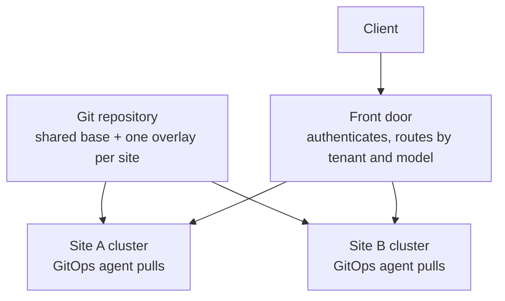

# Federation, multi-tenant observability and identity

**Status: design, not implemented.** Nothing here was built or tested in this lab. Statements about products come from their documentation or repositories, read on 2026-11-25, and should be checked against current releases before any decision.

Starting point: the lab has two tenants on one node, one shared Prometheus without tenant separation, and a model server with no authentication.

## 1. Federation across university sites

**Shape.** One cluster per site. Each site keeps its own hardware, data and administrators, and stays usable if the link to others fails. Nothing below stretches one Kubernetes cluster across sites.

- **Rollout.** Each cluster runs its own GitOps agent (Argo CD or Flux) and pulls a shared base with a site overlay, the same kustomize pattern as [`k8s/tenants/`](../k8s/tenants/). Pulling avoids a central system holding admin credentials for every site. Roll out to one site first, check, then the rest.
- **Front door.** Routes on tenant and model: to the tenant's home site by default; elsewhere only if that tenant's data-protection rules allow it. Residency is a routing rule that must **fail closed**: an unavailable home site gives an error, not a silent move.
- **Model catalogue.** Pinned manifests as in [model requests](model-requests.md), with each site holding its own mirror.
- **Open questions.** Who runs the front door, and is it a single point of failure? Who answers for an incident that crosses sites? How is usage accounted between institutions?

## 2. Observability for several tenants

### Options

| | A. A separate stack per tenant | B. Shared backend with tenant IDs |
|---|---|---|
| Isolation | Strong by construction: separate processes and storage | Depends on every request carrying the right tenant ID, set by something the tenant cannot control |
| Cost | Repeated overhead per tenant | Shared overhead; noisy tenants can affect others |
| Per-tenant retention and limits | Natural: one configuration each | Only what the backend supports (below) |
| Cross-tenant view for operators | Needs a federation layer | Built in, and therefore needs its own access control |
| Operations | Many small upgrades | One larger, more critical system |

### Candidate components

| Component | Licence (repository) | Tenant features according to its documentation |
|---|---|---|
| Prometheus | Apache-2.0 | None built in; use one per tenant, or a label-enforcing proxy such as `prom-label-proxy` (Apache-2.0) |
| Thanos (Receive) | Apache-2.0 | Tenant from the `THANOS-TENANT` header, separate TSDB per tenant; per-tenant limits are marked experimental |
| Cortex | Apache-2.0 | Multi-tenant by design (features not checked for this note) |
| Grafana Mimir | **AGPL-3.0** | Tenant from `X-Scope-OrgID`; per-tenant limit overrides; **does not authenticate**, needs a proxy that sets the header |
| VictoriaMetrics (cluster) | Apache-2.0 | Tenant by account ID in the open-source cluster; **per-tenant retention is an Enterprise feature**; authentication in a proxy |
| Loki (logs), Grafana (dashboards) | **AGPL-3.0** | Not checked for this note beyond the licence |
| OpenTelemetry Collector | Apache-2.0 | Collection and routing, not storage |
| OpenSearch | Apache-2.0 | Not checked for this note beyond the licence |

AGPL-3.0 carries obligations when modified software is offered over a network; the institution's legal advice should settle that before choosing, not after.

### What to settle per tenant

- **Ingestion limits:** samples or bytes per second, with rejected data visible to the tenant.
- **Cardinality limits:** maximum active series and labels. Inference metrics labelled by user, request or prompt would explode this; forbid such labels.
- **Retention:** per tenant, following what the tenant's data-protection rules require. Prompts and answers should not enter metrics or logs by default.
- **Query limits:** time range, series touched, concurrency, timeout, so one dashboard cannot starve the others.

### How to compare fairly

1. **Candidates:** option A (Prometheus per tenant) against one or two forms of B, versions and configurations committed to Git.
2. **Identical load:** the same recorded or generated series, the same number of tenants, churn and query set, on the same hardware, one candidate at a time.
3. **Criteria, fixed before running:** memory, CPU and disk used; ingestion and query latency; effect on a quiet tenant when a noisy one exceeds its limits; whether any request can read another tenant's data (including a forged tenant header); behaviour when a component is killed; steps needed to add and remove a tenant; licence.
4. **Record:** raw results, repeated runs with intervals as in [`bench.py`](../benchmark/bench.py), every limit that had to be changed, and what could not be configured at all.

No candidate is recommended here: that needs the measurements.

## 3. Identity across institutions

- **People:** institutions already have identity federations, commonly SAML-based (eduGAIN, DFN-AAI). The service should accept those logins, not create new accounts.
- **A bridge is likely needed.** Applications prefer OpenID Connect. Keycloak (Apache-2.0) can broker individual SAML or OIDC providers, but community reports and CERN's described setup indicate it does not consume a multilateral SAML federation by itself; CERN puts SATOSA in front of it. Check this early with the national federation operator.
- **Authorisation:** map institution and group attributes to a tenant. Deny by default when an attribute is missing; remove access when the person leaves.
- **Programs:** per-tenant API keys at the gateway, hashed, expiring, revocable, with rate and token budgets. Keys identify a project; keep a named owner for each.
- **Between components:** the gateway sets the tenant identity that observability and quota systems use. Headers like `X-Scope-OrgID` must be overwritten at the gateway, never passed through from a client.

## Sources

- [Mimir authentication and authorization](https://grafana.com/docs/mimir/latest/manage/secure/authentication-and-authorization/), [Mimir configuration parameters](https://grafana.com/docs/mimir/latest/configure/configuration-parameters/)
- [VictoriaMetrics cluster version](https://docs.victoriametrics.com/victoriametrics/cluster-victoriametrics/)
- [Thanos Receive](https://thanos.io/tip/components/receive.md/)
- [Keycloak identity brokering](https://docs.redhat.com/en/documentation/red_hat_build_of_keycloak/26.2/html/server_administration_guide/identity_broker), [CERN authentication and authorisation talk](https://indico.cern.ch/event/1678348/contributions/7063020/attachments/3314358/5932219/The%20Many%20Faces%20of%20Authentication%20and%20Authorisation%20at%20CERN.pdf)
- Licences: the licence field of each project's GitHub repository.
