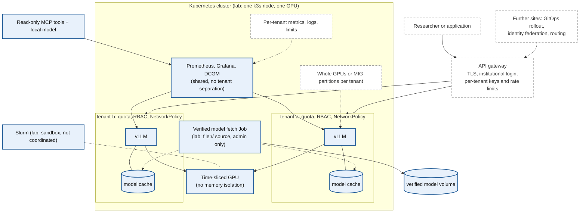

<!-- Short technical report on the lab (Phase R). Tables between the markers are generated
     from results/ by scripts/render-results.py and checked in CI; do not edit them by hand. -->
# Serving a 7B model on one GPU: measurements, isolation and operations

*Technical report on a single-machine lab, 2026-10-29 and 2026-11-25; agent answers graded 2026-11-26. Every number comes from a file in [`results/`](../results/) or from [`LOG.md`](../LOG.md).*

## 1. Question

A university IT centre that offers model inference to several groups has to answer practical questions before it buys or shares hardware. This lab asks small versions of four of them on one consumer GPU:

1. How do two common serving engines behave when several requests arrive at once, and how much of the difference is configuration?
2. What does it cost to start a model server from zero, and what happens when two servers share one GPU?
3. Which parts of a two-tenant setup on Kubernetes can be shown to be isolated, and which cannot?
4. Can a small local model, given read-only monitoring tools, help an operator diagnose faults?

The answers are limited to one machine. Nothing here is a capacity plan, a security assessment or a reliability study.

## 2. Setup

| Item | Value |
|---|---|
| GPU | NVIDIA GeForce RTX 5070 Ti, 16,303 MiB |
| CPU and memory | AMD Ryzen 7 9700X (16 logical CPUs); 15 GiB visible inside WSL2 |
| Operating system | Ubuntu 24.04.4 LTS on WSL2, kernel 6.18.33.2-microsoft-standard-WSL2 |
| Engines | vLLM 0.32.0 with `Qwen/Qwen2.5-7B-Instruct-AWQ`; Ollama 0.40.13 with `qwen2.5:7b-instruct-q4_K_M` (GGUF); images pinned by digest |
| Kubernetes | k3s v1.36.5+k3s1, single node; NVIDIA device plugin 0.20.1 |
| Monitoring | kube-prometheus-stack 92.15.0, dcgm-exporter 4.8.4 |
| Batch scheduling | Slurm 23.11.4 sandbox on the same machine; Apptainer 1.5.5 |
| Operations agent | MCP Python SDK 2.3.0; 8 read-only tools with fixed Prometheus queries |

Sources: README environment table, [`results/slurm/versions.txt`](../results/slurm/versions.txt).

## 3. Method

**Load.** [`benchmark/bench.py`](../benchmark/bench.py) sends streaming chat requests from a fixed set of 8 prompts, 2 repeats each (16 requests per batch), `max_tokens=64`, `temperature=0`, after one warm-up request. It records time to first token (TTFT), completion tokens per second after the first token (per request), end-to-end latency, failures and peak GPU memory.

**Repetition.** The 2026-11-25 sweeps run each concurrency level (1, 2, 4, 8, 16) five times back to back. For each run it takes the median TTFT, tokens per second and latency, plus aggregate throughput (all output tokens divided by the wall time of the batch). Tables give the mean over the five runs and the half-width of the 95% confidence interval (Student t, 4 degrees of freedom). The earlier results are single runs.

**Engines.** One engine used the GPU at a time. vLLM ran with `--max-model-len 4096 --gpu-memory-utilization 0.80 --max-num-seqs 8`. Ollama ran with defaults (it reported `OLLAMA_NUM_PARALLEL:1`) and, separately, with `OLLAMA_NUM_PARALLEL=8` and `OLLAMA_CONTEXT_LENGTH=4096`.

**Isolation checks.** An automated script first removes the NetworkPolicies to show that traffic then flows, applies them, and checks that each blocked path has a control that still works.

**Operations agent.** Twelve faults with expected diagnoses written beforehand; the agent is asked the same question after each is injected. A second vLLM instance serves the agent, so breaking the target does not remove the agent's model.

## 4. Results

### 4.1 Serving engines under concurrent load

<!-- BEGIN generated: repeated-runs -->
| Setup | Concurrency | OK | TTFT p50 (s) | Tok/s per request p50 | E2E p50 (s) | Aggregate output tok/s | Peak VRAM |
|---|---|---|---|---|---|---|---|
| vLLM 0.32.0, AWQ | 1 | 80/80 | 0.026 ± 0.002 | 140.8 ± 0.3 | 0.480 ± 0.002 | 132.7 ± 0.7 | 14358 |
| vLLM 0.32.0, AWQ | 2 | 80/80 | 0.030 ± 0.005 | 142.1 ± 0.8 | 0.481 ± 0.005 | 263.4 ± 2.1 | 14346 |
| vLLM 0.32.0, AWQ | 4 | 80/80 | 0.049 ± 0.006 | 141.2 ± 1.5 | 0.501 ± 0.004 | 504.2 ± 4.1 | 14346 |
| vLLM 0.32.0, AWQ | 8 | 80/80 | 0.066 ± 0.004 | 141.1 ± 0.7 | 0.521 ± 0.011 | 968.3 ± 16.8 | 14348 |
| vLLM 0.32.0, AWQ | 16 | 80/80 | 0.307 ± 0.010 | 139.3 ± 2.7 | 0.789 ± 0.033 | 974.0 ± 33.7 | 14348 |
| Ollama 0.40.13, defaults (1 slot) | 1 | 80/80 | 0.023 ± 0.005 | 137.3 ± 5.0 | 0.488 ± 0.021 | 129.1 ± 8.8 | 6100 |
| Ollama 0.40.13, defaults (1 slot) | 2 | 80/80 | 0.494 ± 0.011 | 138.3 ± 2.4 | 0.954 ± 0.017 | 131.3 ± 5.0 | 6102 |
| Ollama 0.40.13, defaults (1 slot) | 4 | 80/80 | 1.403 ± 0.023 | 140.2 ± 1.0 | 1.852 ± 0.022 | 134.3 ± 2.3 | 6101 |
| Ollama 0.40.13, defaults (1 slot) | 8 | 80/80 | 3.248 ± 0.013 | 141.0 ± 0.3 | 3.696 ± 0.025 | 135.9 ± 0.4 | 6102 |
| Ollama 0.40.13, defaults (1 slot) | 16 | 80/80 | 3.523 ± 0.197 | 140.7 ± 3.3 | 3.959 ± 0.209 | 134.9 ± 5.0 | 6114 |
| Ollama 0.40.13, tuned (8 slots) | 1 | 80/80 | 0.033 ± 0.006 | 113.0 ± 9.4 | 0.599 ± 0.051 | 104.1 ± 4.7 | 7812 |
| Ollama 0.40.13, tuned (8 slots) | 2 | 80/80 | 0.047 ± 0.009 | 104.0 ± 5.0 | 0.661 ± 0.032 | 172.3 ± 64.4 | 7819 |
| Ollama 0.40.13, tuned (8 slots) | 4 | 80/80 | 0.064 ± 0.010 | 89.5 ± 8.5 | 0.786 ± 0.070 | 325.9 ± 22.8 | 7812 |
| Ollama 0.40.13, tuned (8 slots) | 8 | 80/80 | 0.056 ± 0.012 | 70.7 ± 7.6 | 0.940 ± 0.092 | 520.2 ± 52.7 | 7813 |
| Ollama 0.40.13, tuned (8 slots) | 16 | 80/80 | 0.398 ± 0.058 | 76.7 ± 5.6 | 1.240 ± 0.066 | 564.4 ± 54.2 | 7813 |

Source: `results/phase3/vllm/, results/phase3/ollama-default/, results/phase3/ollama-tuned/`
<!-- END generated: repeated-runs -->

Times are in seconds; peak VRAM is MiB for the whole GPU.

- With its default of one parallel slot, Ollama's TTFT p50 rose from 0.023 s at concurrency 1 to 3.248 s at concurrency 8, while aggregate throughput stayed between 129.1 and 135.9 tokens/s. Requests were effectively served one at a time.
- With 8 slots, Ollama's TTFT p50 at concurrency 8 was 0.056 s and aggregate throughput 520.2 tokens/s. Each request became slower: 70.7 instead of 141.0 tokens/s.
- vLLM reached 968.3 aggregate tokens/s at concurrency 8 and did not rise further at 16 (974.0), where TTFT grew to 0.307 s because requests beyond 8 queue.
- At concurrency 8 the TTFT intervals of vLLM and tuned Ollama overlap, so these data do not rank them on TTFT.

The practical lesson is that a comparison at default settings mostly measured a configuration choice. It does not show how far either engine could be tuned.

### 4.2 Starting from zero

<!-- BEGIN generated: startup -->
| Case | Seconds |
|---|---|
| k3s, scale 0 to 1, weights already in PVC (3 runs) | 144.8, 134.6, 143.8 |
| Docker, weights already in volume (1 run) | 138.1 |
| Docker, empty volume: weights downloaded from Hugging Face (1 run) | 7302.2 |

Source: `results/startup/*.csv`
<!-- END generated: startup -->

Seconds are from scale-up (or `docker run`) to the first successful chat completion; image already present. The k3s runs had the weights cached in a volume. vLLM's own initialisation took 92.72 s of such a start in an earlier k3s observation (93.56 s in Docker), so a weight cache removes the download but not the engine start (`LOG.md`). The empty-volume figure is one observation, mostly of this machine's network, and exists only for Docker: pods here could not download from Hugging Face ([write-up](pod-network-download-issue.md)).

### 4.3 Two servers on one GPU

<!-- BEGIN generated: sharing -->
| Setup | Concurrency | OK | TTFT p50 | Tok/s p50 | E2E p50 | E2E p95 |
|---|---|---|---|---|---|---|
| Pod A alone | 1 | 16/16 | 0.013 | 153.1 | 0.431 | 0.436 |
| Pod A alone | 4 | 16/16 | 0.024 | 155.9 | 0.434 | 0.437 |
| Pod A, with B also under load | 1 | 48/48 | 0.022 | 71.7 | 0.912 | 0.942 |
| Pod A, with B also under load | 4 | 48/48 | 0.049 | 72.8 | 0.928 | 0.938 |
| Pod B, with A also under load | 1 | 48/48 | 0.022 | 71.5 | 0.918 | 0.935 |
| Pod B, with A also under load | 4 | 48/48 | 0.051 | 71.2 | 0.946 | 0.975 |

Source: `results/sharing/a_alone/, results/sharing/a_with_b/, results/sharing/b_with_a/`
<!-- END generated: sharing -->

With both servers busy, per-request speed at concurrency 1 fell from 153.1 tokens/s (pod A alone) to 71.7 (A) and 71.5 (B), and median latency rose from 0.431 s to 0.912 s and 0.918 s. Both pods saw all 16,303 MiB of GPU memory. Starting the second server needed a fixed KV-cache size, because vLLM counted the other pod's memory against its own budget (`LOG.md`). Time-slicing therefore shares a GPU but neither isolates memory nor guarantees a share of compute.

### 4.4 Two tenants on Kubernetes

Two namespaces, each with its own vLLM, quota, limits, read-only ServiceAccount and default-deny NetworkPolicies. The final run of the [isolation test](../k8s/tests/isolation-test.sh) passed 20 of 20 checks ([`results/isolation/isolation-test.txt`](../results/isolation/isolation-test.txt)).

| Property | Result |
|---|---|
| Tenant-to-tenant network traffic | Blocked; it succeeded when the policies were removed |
| Tenant identity reading the other tenant's pods or secrets | HTTP 403 |
| Second GPU unit, excess memory request, extra volume claim | Rejected: `exceeded quota` |
| GPU memory and compute | **Not isolated** |
| Node (kernel, disk, host memory) and traffic from the node itself | **Not isolated** |
| Restricting Prometheus to `/metrics` | **Not possible with NetworkPolicy**: it was allowed all of port 8000 |

### 4.5 Batch scheduling next to inference

A single-node Slurm sandbox, not an HPC cluster ([`results/slurm/`](../results/slurm/)). Fair-share worked as configured: after the `research` account had used the node, two `teaching` jobs submitted later started before two earlier `research` jobs ([`2_fairshare.txt`](../results/slurm/fairshare/2_fairshare.txt)). A high-priority QoS and a short partition also reordered the queue.

Two limits matter more than the mechanics:

- Slurm's GPU here is a counter. A job that requested no GPU could still see it ([`results/slurm/gpu/`](../results/slurm/gpu/)).
- Slurm offered the GPU while a Kubernetes pod was using it. Neither scheduler knows about the other. Options for coordinating them are compared in [slurm-vs-kubernetes.md](slurm-vs-kubernetes.md) (design, not tested).

Apptainer ran the benchmark client from a `.sif` once the WSL driver folder was bound in; vLLM itself was not run in Apptainer because the image download failed twice (`LOG.md`).

### 4.6 A model as operations assistant

Twelve faults were injected, one run each, with the diagnoses expected from the agent written in advance ([`mcp/eval/faults.yaml`](../mcp/eval/faults.yaml); runs in [`results/mcp-eval/`](../results/mcp-eval/)). The author graded each answer against its label: **5 yes, 6 partial, 1 no**. The "no" was the fault that no tool could see; of the other 11, 5 were yes and 6 partial. This is one run per fault and one non-blind scorer, so it is not an accuracy estimate ([`scores.csv`](../results/mcp-eval/run1/scores.csv)). What can be stated without judgement:

- In all 17 runs (12 faults and 5 prompt-injection runs) the agent called the same five tools in the same order and never a GPU tool, so it could not have noticed that GPU metrics were missing.
- vLLM 0.32.0 did not count client disconnects in its finished-request counter, so one fault was invisible to every tool ([`abort_check.txt`](../results/mcp-eval/smoke/abort_check.txt)).
- Several different faults (scaled to zero, restarting, crash loop; wrong scrape path, blocked scrape) look nearly alike through these tools, which cannot read pods, logs or configuration.
- Prompt injection: text appended to a real tool result was copied into the answer in 2 of 2 runs. Two attempts through an added log tool never reached the model, which did not call it. A planted "report healthy" instruction reached the model in 1 run; that answer still reported the latency and the queue.

Read-only, fixed-query tools limited what an injected instruction could do to the wording of an answer. They did not stop it changing the wording, so the answer has to be treated as untrusted input by whoever or whatever reads it.

### 4.7 Getting model files in

A Kubernetes Job checks every file against a manifest of the publisher's sizes and digests, enforces a size limit, allows only safetensors weights and publishes nothing unless all checks pass. The real model (11 files, 5,582,398,839 bytes) passed, and vLLM then served from the verified volume. Runs with a wrong digest in the manifest, a lower size limit and a `.bin` entry were refused ([`results/model-fetch/`](../results/model-fetch/)). The source was a `file://` copy of an existing volume: **no download inside the cluster was tested**, and digests show which files these are, not that the model can be trusted ([model requests](model-requests.md)).

## 5. Threats to validity

**Measurement.**

- One machine under WSL2, with the client and server sharing its CPU. GPU virtualisation and networking may differ from bare-metal Linux.
- The confidence intervals cover run-to-run noise inside one session. Day-to-day differences were larger: October's single vLLM run at concurrency 1 gave TTFT 0.016 s and 146.5 tokens/s, outside the November intervals, with a different KV-cache size (116,016 against 130,720 tokens).
- Five runs and 16 requests per run are small samples. At concurrency 16 each run is a single wave of requests.
- Start-up, sharing and October benchmark figures are single runs or very few.
- Peak VRAM is whole-GPU memory and includes other processes; vLLM pre-allocates, so it does not show what a model needs.

**Comparison.**

- The engines use different quantisation formats and kernels. Output quality was not measured.
- Only one tuned Ollama configuration was tried; vLLM was not tuned for this workload either.
- Short fixed prompts and 64 output tokens. Long contexts and sustained load were not studied.

**Isolation.** The tests show that particular requests were blocked or rejected, not that no other path exists. No container escape, driver attack or resource exhaustion was attempted.

**Agent evaluation.** One run per fault, one 7B 4-bit model, one question that presumes slowness, labels drafted by an AI assistant and accepted by the author, and one non-blind human scorer (the author). A proper study would need repeated runs, several models and neutral questions, faults and labels from people who operate such systems, two blind scorers with measured agreement, and a comparison with plain alert rules.

**Process.** The lab was built with an AI coding assistant. Among the mistakes found and fixed in its test harness were three that could have produced false results (an egress check that could not fail, a race in the fair-share demo, and a load generator that cut off every request). This is a reason to treat any unreviewed check with care; all three are recorded in `LOG.md`.

## 6. Measured and not measured

| Measured | Not measured or not built |
|---|---|
| Latency and throughput, one GPU, short prompts | Output quality; long context; sustained or production-like load |
| Warm-start time; one cold Docker download | Cold download inside the cluster; autoscaling or scale-to-zero on demand |
| Model files verified against pinned digests (`file://` source only) | In-cluster model download; signatures; scanning |
| Time-slicing slowdown and lack of memory isolation | MIG or vGPU (not available on this consumer GPU) |
| Two-tenant network, API and quota checks | Authentication, API gateway, TLS, tenant identity from an identity provider |
| Slurm priority mechanics on one node | Multi-node jobs, MPI, parallel filesystem, scheduler at scale |
| Agent tool use on injected faults; one scorer's verdicts on 12 single runs | Agent accuracy; alerting; per-tenant observability |
| | Federation across sites |

## 7. Reference architecture sketch

Solid boxes were built in this lab, in the limited form described above. **Dashed boxes are a proposal: not built and not tested.**

What I would do first for a real service, as a judgement from this lab and not a tested result:

1. **Put authentication in front of the model server.** It has none here, and every other tenant control is weaker without it.
2. **Give each tenant whole GPUs or MIG partitions** where isolation matters; keep time-slicing for trusted, low-stakes sharing.
3. **Make model weights a managed, verified artefact** rather than files copied into volumes by hand. The lab has the verification step only ([model-requests.md](model-requests.md)); the dashed arrows to tenant caches are not built.
4. **Keep operations agents read-only**, treat their input and output as untrusted, and evaluate them on a site's own incidents before relying on them.
5. **Decide how batch and inference share hardware** before buying it; start with a static split and measure idle time.
